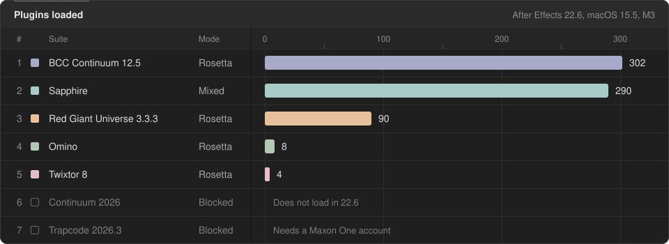

<h1 align="center">AE 2022 on Apple Silicon</h1>

<p align="center"><b>Keep After Effects 2022 and its older plugins working on a new Mac.</b><br>
Launchers, checks and plain-language notes on Rosetta, plugin caches and the errors that waste an afternoon.</p>

<p align="center">
  
  
  
  
  
  
</p>

<p align="center">
  
</p>

## Why this exists

After Effects 2022 is the last version a lot of older plugin suites were built for, and most of those suites are Intel-only. AE 2022 itself runs natively on Apple Silicon, but a plugin is loaded into AE's own process, so a native AE cannot load an Intel plugin. On an M-series Mac that shows up as plugins missing from the Effects menu, an "incompatible plugins" warning at startup, effects that fail with `(25 :: 3)`, and panels that are listed but never open.

Upgrading After Effects does not fix this, it removes the way out. Running AE under Rosetta is what lets Intel plugins load, and [Adobe dropped Rosetta support in version 24.0](https://helpx.adobe.com/after-effects/kb/after-effects-apple-silicon.html). AE 2022 and 2023 are the last versions that can still load them on an M-series Mac.

Nearly all of it comes down to three things: which mode AE was started in, what AE has cached about your plugins, and which versions of a suite are installed side by side. This repo has a script for each.

## Native or Rosetta

AE 2022 can start in two modes. Pick per session.

| | Native (arm64) | Rosetta (x86_64) |
|---|---|---|
| **Starts in** | About 5 seconds | A minute or more while it scans plugins |
| **Loads** | Universal plugins only | Universal and Intel-only plugins |
| **Use it for** | Projects that only use built-in or universal effects | Anything using older suites |
| **Start it with** | `scripts/launch-native.command` | `scripts/launch-rosetta.command` |

A project saved in one mode opens in the other. Effects from plugins that did not load show as missing until you reopen under Rosetta.

The first Rosetta launch is much slower than the rest: macOS translates AE and every Intel plugin once and stores the result, which took more than six minutes on the test machine. Later launches reuse it.

## Getting started

You need an Apple Silicon Mac with After Effects 2022 installed. Clone the repo and run the preflight:

```bash
git clone https://github.com/tbhtho/AE2022-Apple-Silicon.git
cd AE2022-Apple-Silicon/scripts
./preflight.command
```

The preflight finds your After Effects, checks your macOS version, and lists what it would change before asking. It can install Rosetta 2 if it is missing, hide the two startup warnings, and clear the plugin cache so the next launch rescans everything. `--check` only reports.

Then launch in the mode you need. The `.command` files can also be double-clicked in Finder.

```bash
./launch-rosetta.command "/path/to/project.aep"
```

To see which of your plugins need Rosetta, run `./plugin-arch.sh`.

> [!NOTE]
> If AE is installed somewhere else, set `AE_APP` to the full path of the `.app` before running a script.

## Scripts

| Script | What it does |
|---|---|
| [`preflight.command`](scripts/preflight.command) | Find AE, check your Mac, apply the settings Rosetta needs |
| [`launch-rosetta.command`](scripts/launch-rosetta.command) | Start AE under Rosetta, with every plugin |
| [`launch-native.command`](scripts/launch-native.command) | Start AE natively, fast |
| [`restart-clean.command`](scripts/restart-clean.command) | Restart AE with the plugin cache cleared |
| [`doctor.sh`](scripts/doctor.sh) | Report on your Mac, AE and caches |
| [`plugin-arch.sh`](scripts/plugin-arch.sh) | Show which plugins need Rosetta |
| [`ae-warnings.py`](scripts/ae-warnings.py) | Hide the Rosetta and incompatible-plugins startup warnings |
| [`cep-doctor.sh`](scripts/cep-doctor.sh) | Fix an extension panel that will not open |
| [`bcc-host-check.sh`](scripts/bcc-host-check.sh) | Check whether your Continuum version supports your AE |

Only `preflight`, `restart-clean`, `ae-warnings` and `cep-doctor fix` change anything. Each script explains itself in its first lines.

## Tested plugins

On a MacBook Pro M3, macOS 15.5, After Effects 22.6.

| Plugin | Mode | Result |
|---|---|---|
| BCC Continuum 12.5 | Rosetta | **Working** |
| Sapphire | Rosetta | **Working** |
| Red Giant Universe 3.3.3 | Rosetta | **Working** |
| Twixtor 8, RSMB, Optical Flares, Twitch, Omino, PixelSorter 2 | Rosetta | **Working** |
| FXConsole, Signal | Either | **Working** |
| Flow panel | Either | **Working** after `cep-doctor.sh fix` |
| Continuum 2026 | | Does not support AE 2022 |

You need your own licence for After Effects and each plugin. Nothing here installs or unlocks software.

## Continuum and the (25 :: 3) error

"This effect cannot be applied because it cannot be initialized (25 :: 3)" means AE found the plugin and the plugin refused to start. With Boris FX Continuum it is one of two things:

| Cause | Fix |
|---|---|
| Your Continuum is too new. 2025 and 2026 need AE 2023 or later | Use Continuum 12.5, or 2024 (v17), the last release that lists AE 2022 |
| Two Continuum versions are installed and share one engine | Keep only one. Uninstall the other, then run `restart-clean.command` |

`bcc-host-check.sh` tells you which one you have.

## When Rosetta goes away

Everything here depends on Rosetta 2. Apple has said Rosetta stays fully available through macOS 27, and that Intel-only apps stop launching on Apple Silicon with macOS 28.

> [!IMPORTANT]
> Once that happens and Apple removes Rosetta's backwards compatibility, I will likely build my own replacement so After Effects 2022 and its Intel plugins can keep running. That is a plan, not a promise or a date. Until then, stay on macOS 27 or earlier on any Mac you need these plugins on.

## Related

[AE Timeline Zoom](https://github.com/tbhtho/zoom) is a small menu-bar app that adds scroll-wheel zoom to the AE 2022 timeline: hold Command and scroll to zoom around the pointer.

## Licence

GPL-3.0-or-later, see [LICENSE](LICENSE). Copyright (C) 2026 tbhtho. Not affiliated with or endorsed by Adobe, Apple or any plugin vendor named here.
